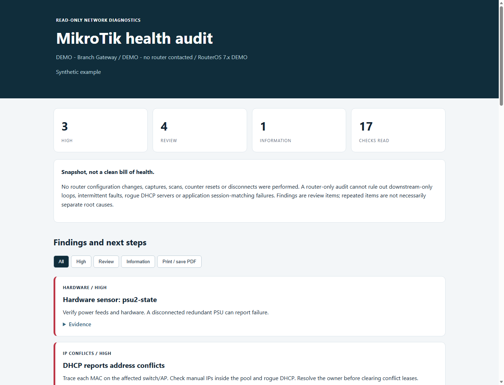

# MikroTik Healthcheck

A read-only SSH audit with a standalone, responsive HTML report and a JSON findings report.
It prompts for the router address, SSH username and a hidden password. Reports stay on your computer. No credentials or production reports are included in this repository.



[Download the latest source](https://github.com/Omidcr77/mikrotik-healthcheck/archive/refs/heads/main.zip) | [Example HTML report](example-report.html) | [MIT license](LICENSE)

## Run

Requires Python 3.10 or newer and SSH access to the router. Works from Windows, Linux or macOS.

```console
git clone https://github.com/Omidcr77/mikrotik-healthcheck.git
cd mikrotik-healthcheck
python -m pip install -r requirements.txt
python mikrotik_healthcheck.py
```

On Windows, you can double-click `run_healthcheck.bat` after installing the dependency.
The reports are written to the local `reports` directory. Open the HTML file in a browser.
Use severity filters, expand evidence, and click **Print / save PDF** to make a printable report.
No Internet connection is needed to view the report; CSS and JavaScript are embedded.

Example with optional parameters (the password is still prompted):

```console
python mikrotik_healthcheck.py --host 192.0.2.1 --user admin --port 22 --interval 30 --timeout 15 --portal-ip 192.0.2.2
```

Generate a synthetic demonstration without any router access:

```console
python mikrotik_healthcheck.py --demo --output example-report
```

## What it checks

- CPU, free memory/storage, connection-tracking utilization and available temperature/PSU/fan sensors.
- Two snapshots of Ethernet/interface counters: current errors, drops, link-downs, traffic rates and broadcast/multicast activity.
- Link negotiation and half duplex; enabled EoIP tunnels that are down; WireGuard handshake/endpoint state.
- DHCP conflict/declined leases, invalid DHCP servers, pool utilization and IP-to-MAC changes.
- Repeated IPs among active PPP and Hotspot sessions, with a routing-domain caveat.
- Unresolved Hotspot pool references, portal addresses outside the interface subnet and disabled RADIUS accounting.
- Broad masquerade candidates and TCP redirects to HTTP without a destination-port restriction.
- Authentication retry patterns, address-allocation errors and loop/conflict-related logs.
- Explicit warning-log coverage, STP-disabled multiport bridges and loop-protect configuration.
- The Dude, largest files, disk-backed interface graphs and free-space changes.

The tool gathers routing and session metadata, but does not claim to infer a complete downstream topology or prove routing-loop absence.

## Compatibility: broad support, not an all-versions guarantee

Designed for RouterOS v6 and v7, including RouterBOARD/CCR/CHR platforms that expose the relevant commands over SSH.
It tries modern JSON output first, then a length-framed `print as-value` reader, then a conservative classic CLI parser.
Properties and menus differ by RouterOS version, model, package and account permissions. Missing capabilities appear in **Collection coverage**, rather than being silently marked healthy.

Validated live on RouterOS 7.22.1 (CCR1036), including forced legacy framed collection. Offline tests cover both modern and classic parsing behavior. No actual RouterOS v6 device was available for testing. Historical v5/older releases and every hardware model are **not certified**. Very old SSH implementations may fail to negotiate with modern Paramiko; this tool does not automatically weaken cryptography.

## Read-only behavior and credentials

- Uses fixed `print`, `monitor ... once`, `:foreach`, `:put` and serialization expressions; variables are local to each command.
- Does not change configuration, write router files, add scripts, export configuration, clear counters, disconnect users, run scans, capture packets, run bandwidth tests or restart anything.
- Does not send probes to downstream devices or sign in to the portal on behalf of subscribers.
- Reads can still consume resources and create normal SSH login/audit records. Run one audit at a time on busy routers.
- Passwords are entered with `getpass` and never passed on the command line or saved in reports.
- Host keys are verified. For a new host, compare the displayed SHA256 fingerprint with a trusted source before answering `yes`. Keys are remembered in `~/.mikrotik-healthcheck/known_hosts`. A changed known key is rejected.
- `--fingerprint SHA256:...` can pin a key non-interactively, but the password is still prompted.
- Property allowlists and redaction prevent known credential/key fields from reaching reports. Reports do contain IP/MAC addresses, subscriber names, filenames and selected log messages. Inspect before sharing.
- Use an account with only the read and SSH permissions needed in your environment. The program does not create or modify accounts. Unsupported/denied reads reduce coverage.

## Interpreting results

A high-priority finding means there is concrete evidence needing attention, not proof that it caused a particular complaint.
For example, a reported PSU failure can be an unplugged redundant supply, and a DHCP conflict does not identify both competing devices.

Broadcast review thresholds are 1,000 received broadcast packets/s or 5,000 multicast packets/s. These are review thresholds, not universal storm definitions. Multicast applications can legitimately exceed them. EoIP-encapsulated broadcasts can appear as unicast on the physical uplink. A downstream switch can contain a loop invisible to the main router.

Counter resets and reboots suppress invalid rate comparisons. A single successful SSH audit cannot rule out intermittent issues. Historical error totals alone are not presented as current error rates.

NAT findings describe candidate configuration problems. They do not simulate complete rule matching, connection tracking, routing policy or actual server-side source addresses. `--portal-ip` records context only; DeltaSib backend settings, its web logs, accounting database, and automatic-login session matching require a separate server-side investigation.

No automatic repairs are included. Review the evidence and topology before making changes.

## Tests

```console
python -m unittest -v test_healthcheck.py
```

## References

- RouterOS scripting / print as-value: https://help.mikrotik.com/docs/spaces/ROS/pages/47579229/Scripting
- Ethernet counters: https://help.mikrotik.com/docs/spaces/ROS/pages/8323191/Ethernet
- DHCP: https://help.mikrotik.com/docs/spaces/ROS/pages/24805500/DHCP
- Loop Protect: https://help.mikrotik.com/docs/spaces/ROS/pages/23396469/Loop+Protect
- Paramiko SSH client and host-key policies: https://docs.paramiko.org/en/stable/api/client.html

## Contributing

Bug reports and pull requests are welcome. Include RouterOS version, model and the failing check, using synthetic or redacted output. Never post passwords, private keys, live subscriber records, or complete production reports. Add a regression test for parser or diagnostic changes. See [CONTRIBUTING.md](CONTRIBUTING.md).

## License

MIT. This is an independent community tool, not an official MikroTik product.
